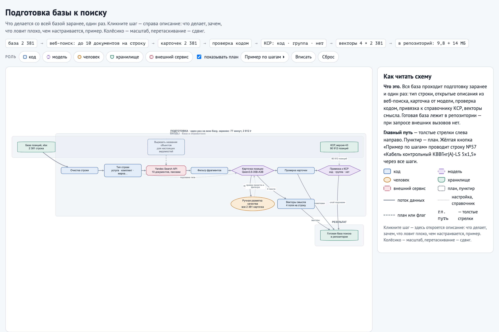
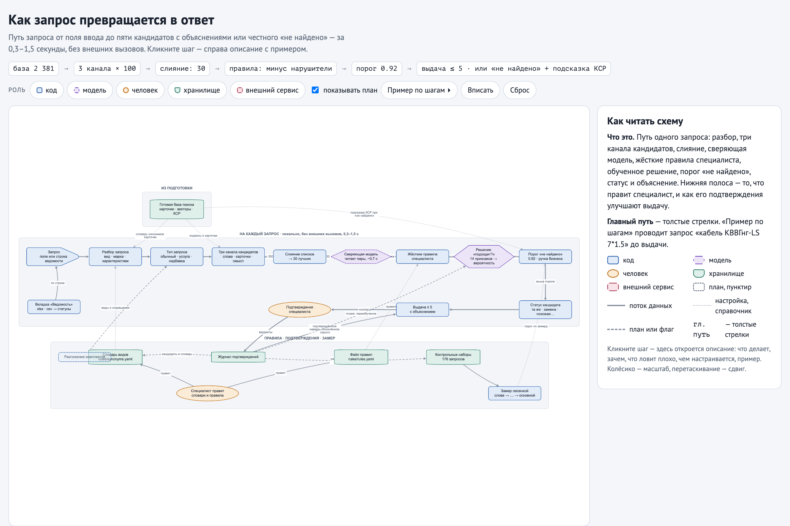
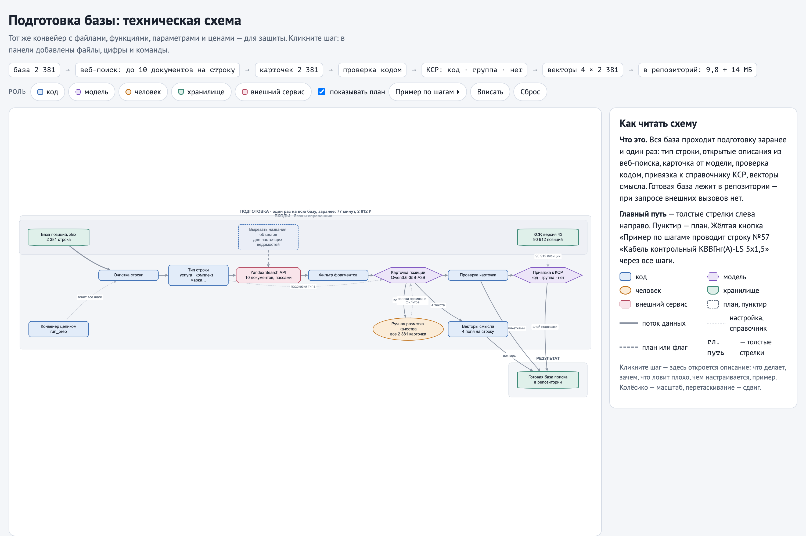
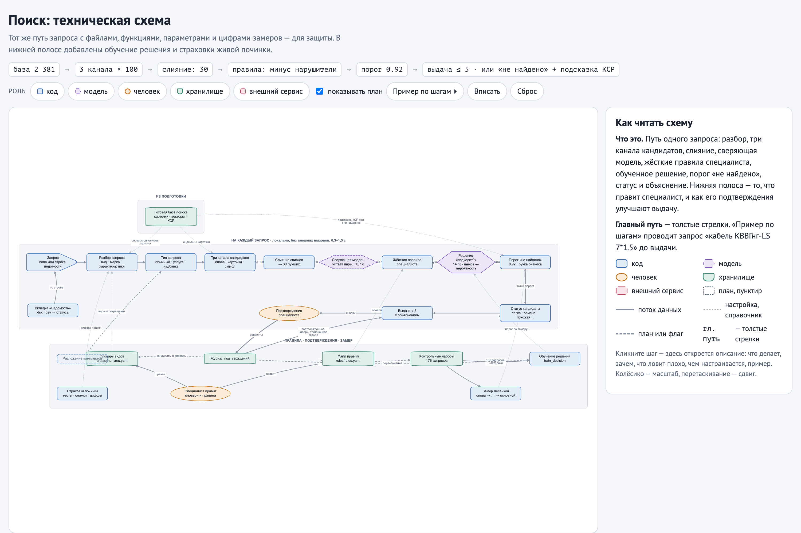

# Поиск аналогов позиций: архитектура

Пользователь вводит наименование материала или оборудования своими словами — система возвращает
до пяти подходящих строк из истории закупок (2 381 строка) с объяснением, чем каждая совпадает
и чем отличается, или честно говорит «не найдено». Поиск работает локально; интернет и платные
модели используются только на подготовке базы.

Главная идея: **грязные строки сметы превращаются в «карточки» заранее**, на подготовке, где можно
потратить время и деньги один раз. Сам поиск — быстрый конвейер: три канала кандидатов → слияние →
жёсткие правила специалиста → обученное решение «подходит или нет» → порог «не найдено» → статус
и объяснение по каждому кандидату.

## Схемы

Схемы интерактивные: клик по шагу открывает панель «что делает · зачем · что ловит плохо · чем настраивается · пример», кнопка «Пример по шагам» проводит сквозной запрос через конвейер, роли подсвечиваются. Простые — чтобы понять устройство; технические — те же шаги с файлами, функциями, параметрами и цифрами замеров. Картинки ниже — статичные кадры.

| Схема | Картинка | Интерактивная версия |
|---|---|---|
| Подготовка базы (простая) |  | [артефакт](https://claude.ai/artifact/WX9K6vLitGvGCDEeG5w5mz) · [docs/schemes/prep-simple.html](docs/schemes/prep-simple.html) |
| Поиск по запросу (простая) |  | [артефакт](https://claude.ai/artifact/5bEAzjJEbyPYWQ8LddNTPJ) · [docs/schemes/search-simple.html](docs/schemes/search-simple.html) |
| Подготовка базы (техническая) |  | [артефакт](https://claude.ai/artifact/FduYYcohzkTVbgLxj7bbfS) · [docs/schemes/prep-tech.html](docs/schemes/prep-tech.html) |
| Поиск (техническая) |  | [артефакт](https://claude.ai/artifact/4Hmas2ZCigZDR6sBVFMzkw) · [docs/schemes/search-tech.html](docs/schemes/search-tech.html) |

HTML-файлы схем лежат в репозитории и открываются в браузере без всяких аккаунтов.

## Подготовка базы: шаги

Выполняется заранее и один раз (77 минут, 2 612 ₽ на всю базу, 1,10 ₽ на строку). Новые строки
дозапускаются тем же конвейером. Человек в подготовке не участвует.

**1. Чистка и тип строки — код.** Убираем номера пунктов и мусор, определяем тип: марка по ГОСТ (245),
типовое обозначение (103), артикул (1192), описание без кода (695), услуга (92), комплект «в составе»
(54), надбавка (10). Зачем: услуги и надбавки не должны всплывать на запрос о материале, а тип
подсказывает модели, как писать карточку. Ловит хорошо услуги (слова в начале строки); на ручной
проверке 120 строк тип совпал в 88 — путается «марка по ГОСТ» с «артикулом», на поиск это не влияет.
Настраивается правилами в `app/nametype.py`.

**2. Открытые описания из интернета — код.** По каждой строке запрос в Yandex Search API, до 10
документов с фрагментами. Зачем: в смете нет описаний, а пользователь пишет другими словами; каталоги
дают эти «другие слова» («огнетушитель ОП-5» → «порошковый, масса заряда 5 кг»). Наружу уходит только
наименование. В настоящих ведомостях названия объектов нужно вырезать до отправки — здесь база уже
обезличена.

**3. Фильтр фрагментов — код.** Выбрасываем страницы про соседний артикул и торговые фразы. Зачем:
иначе модель перепишет в карточку чужие характеристики.

**4. Карточка позиции — ИИ-модель (Qwen3.6-35B-A3B).** По строгой форме: каноническое название,
описание, синонимы, характеристики; только факты из строки и фрагментов. Это единственное место,
где большая модель что-то пишет. Качество по ручной разметке всех 2 381 карточек: годна 21 %,
«в целом верно, с изъяном» 68 %, ошибка 5 %, мало данных 6 %; главный дефект — детали конкретного
продавца в 34 % карточек. Логирование у провайдера выключено заголовком.

**5. Проверка карточки — код.** Числа и марки строки должны быть в карточке, чисел «из воздуха» быть
не должно. Пример пойманного: строка 397 — модель вписала 200, 300, 600, которых нет во входе.
Непрошедшие карточки помечаются.

**6. Привязка к справочнику КСР — ИИ + код.** Классификатор строительных ресурсов Минстроя
(90 912 позиций): «тот же ресурс», «группа» или «нет». В отборе кандидатов не участвует — замер
не показал пользы (0 новых попаданий), — а работает подсказкой при «не найдено» и заготовкой под
смену справочника.

**7. Векторы смысла — локальная модель.** Четыре текста строки (имя, каноническое, синонимы,
описание) переводятся в числовые отпечатки; похожий смысл — похожие числа при разных словах.

## Поиск: шаги

На каждый запрос, 0,3–1,5 секунды. Сквозной пример — «кабель КВВГнг-LS 7*1.5».

**1. Разбор запроса — код.** Вид изделия (первое существительное), марка, характеристики; «3х1,5»,
«3*1.5» и «3×1,5 мм2» читаются одинаково. Разобранное показывается пользователю — видно, что поиск
понял. Ветвления: запрос без вида и марки («1.7.2)») → «недостаточно данных»; запрос-услуга
(«перевозка…») → ищем только среди услуг; «надбавка…» → только среди надбавок.
Словари видов и сокращений — `rules/synonyms.yaml`, их правит специалист.

**2. Три канала кандидатов — код.** Слова наименований (точные написания), слова карточек (синонимы
с подготовки), смысловые векторы (перефразировки). До 100 строк на канал. Зачем три: что пропустит
один, поймает другой; вклад каждого замерен лесенкой (см. «Проверка качества»).

**3. Слияние — код.** Списки складываются по местам (RRF): строка, высокая сразу в нескольких
каналах, поднимается. Дальше 30 лучших.

**4. Сверяющая модель — ИИ локально.** Реранкер читает пары «запрос — кандидат» и оценивает,
об одном ли они. ~0,7 с; выключается флагом (быстрый режим).

**5. Жёсткие правила специалиста — человек задаёт, код применяет.** `rules/rules.yaml`: в прототипе
три правила-допущения («кабель и провод: число жил и сечение строго», «видеокамера: разрешение
±1 ступень», «трансформатор: мощность строго»). Нарушение отбрасывает кандидата с причиной:
на примере — 5х1,5 и 4х1,5 отброшены. Специалист меняет файл, код не трогается; после правки одна
команда показывает, какие запросы изменили выдачу (`scripts/whatchanged.py`).

**6. Решение «подходит или нет» — обученная модель.** Логистическая регрессия по 14 признакам
(согласие каналов, близость по смыслу, совпадение вида, марки и характеристик, оценка сверяющей
модели). Обучена на 136 проверочных запросах; хранится числами в `data/model/decision.json`.
Разобранные характеристики здесь — признаки и материал для объяснения, а не жёсткие фильтры:
жёсткие фильтры на замере ломались на каждой новой манере письма (19 ложных отказов из 80 — П-50).

**7. Порог «не найдено» — код, ручка бизнеса.** Лучшая вероятность ниже порога → честное «не найдено»
плюс ближайшее из КСР. Порог подобран честно (по предсказаниям для невиданных запросов): 0.92
с реранкером, 0.85 без. Выше порог — честнее молчит; ниже — реже отказывает зря.

**8. Статус и объяснение — код.** «Та же позиция» — всё названное в запросе подтверждено; «допустимая
замена» — отличие в пределах правила специалиста или другая марка при совпавших характеристиках;
«похожая» — противоречий нет, но часть характеристик в базе не указана; «с отличием» — показывается
с пометкой, решает человек. Под каждым кандидатом: из чего сложилась оценка, что совпало, что
отличается, чего нет; у комплектов без состава — пометка «состав в строке не расписан».

**Петля улучшения — человек.** Кнопки «та же позиция / замена / не подходит» пишутся в
`data/feedback/feedback.jsonl`. При повторе запроса подтверждённое — наверх с пометкой, отклонённое —
скрыто; без переобучения. Накопленные пары — материал для словаря синонимов, новых правил,
пополнения контрольного набора и, позже, переобучения решения.

**Не реализовано (отмечено на схемах):** разложение комплектов «шкаф с коммутатором и ИБП» на части;
автоперенос подтверждений в словарь; извлечение характеристик из марок («РГП-110/1000» → 110 кВ).

## Выбор моделей и хранилища

- **Векторы — intfloat/multilingual-e5-base** (локальная, русский, CPU, вектор 768). Вклад замерен:
  на 80 запросах верный первым 46 → 72 против чистого поиска по словам, 26 выигрышей без единого
  проигрыша. Альтернатива deepvk/USER2-base подключена в коде, но не замерена — честно вынесено
  в план. Векторы через API не взяты: данные уходят наружу, каждый запрос платный.
- **Сверяющая модель — BAAI/bge-reranker-v2-m3**: покупает честное «не найдено» (23 из 27 против
  16 из 27 без неё на перекрёстной проверке) ценой пары пунктов ранжирования; выключается флагом.
- **Карточки — Qwen3.6-35B-A3B через Yandex AI Studio**: только на подготовке, 0,40 ₽ за вызов.
  В онлайне больших моделей нет.
- **Решение — логистическая регрессия**, не градиентный бустинг и не LLM-судья: 136 обучающих
  запросов — мало для сложных моделей, а веса регрессии читаемы и дают строку «из чего сложилась
  оценка». LLM-судья на каждый запрос отвергнут: дорого, медленно, нестабильно.
- **Хранилище — файлы и перебор в памяти** (2 381 строка ≈ 14 МБ векторов): точный поиск без
  приближений, нулевая инфраструктура. Порог переезда — сотни тысяч строк, см. ограничения.
- **Почему не «отдать всю базу большой модели»**: база ≈ 75 тыс. токенов на каждый запрос, модели
  хуже читают середину длинного контекста, правила замен оказались бы в промпте (ТЗ прямо считает
  это минусом), нельзя указать шаг ошибки и нельзя замерить вклад шагов, а при 500 тыс. строк база
  не влезает ни в одно окно. Модель полезна на подготовке — так и сделано.

## Проверка качества

Протокол: наборы для настройки (dev 16, control 20, big 100 запросов) отделены от двух итоговых
слепых наборов по 20 запросов (писали ChatGPT и Gemini по брифу «перепишите строки базы как другой
человек»; верные ответы размечали ИИ-агенты, не видевшие кода поиска; спорные случаи помечены).
Код и наборы заморожены хэшами до прогона, цифры объявлены заранее, прогон один
(`eval/FREEZE.md`, `eval/JOURNAL.md` — полный журнал правок и замеров).

Итог на двух слепых наборах (32 запроса с ответом, 8 без ответа):

| Вариант | Верный первым | В пятёрке | Другая важная характеристика первой | «Не найдено» | Ложное «не найдено» |
|---|---|---|---|---|---|
| Поиск по словам | 22 из 32 | 29 из 32 | 10 | 0 из 8 | 0 |
| Основной | 28 из 32 | 28 из 32 | 3 | 5 из 8 | 4 |
| Быстрый (без реранкера) | 30 из 32 | 30 из 32 | 5 | 3 из 8 | 2 |

Счёт основного варианта против слов по «верный первым» — 9:3. Лесенка вклада шагов на 100-запросном
наборе: слова 46 → нормализация 64 → карточки 68 → векторы 72 из 80. Честная оценка обобщения —
перекрёстная проверка на 136 запросах: верный первым 91 из 109, «не найдено» 23 из 27.
Разбор ошибок: `eval/final/ERRORS.md` — все четыре ложных отказа на волоске от порога, три из них
из-за вида, названного другим словом («датчик» ↔ «извещатель»).

Построчный просмотр всех пяти наборов — страница замера:
[артефакт](https://claude.ai/artifact/SonMjxTFxt1hvrXcozhyx8) · [docs/eval-browser.html](docs/eval-browser.html).

## Ограничения и план

**Что сломается при 500 тыс. строк.** Перебор в памяти: векторы вырастут до ~3 ГБ, полный косинус
и BM25 в Python станут секундами. Переезд: OpenSearch или Postgres+pgvector (слова + вектора + RRF
из коробки), приближённый поиск HNSW; реранкер — каскадом только для неуверенных запросов; кэш
по нормализованному запросу (тысяча ведомостей в день — это десятки тысяч строк, из них много
повторов). Подготовка: 1,10 ₽ × 500 тыс. = ~550 тыс. ₽ и ~5 дней конвейера — считать заранее,
запускать частями по типам строк.

**Правило специалиста без правки кода.** Файлы `rules/rules.yaml` (замены) и `rules/synonyms.yaml`
(виды и сокращения); проверка правки: `scripts/attrs_diff.py` (что изменилось в разборе базы) и
`scripts/whatchanged.py` (какие запросы изменили выдачу). В проде — то же через страницу
администратора с прогоном на контрольном наборе до включения.

**Подтверждения специалиста.** Уже в прототипе: память пар поверх поиска. Дальше: предложения
в словарь и правила из накопленных пар, пополнение контрольного набора, пересчёт порога; при сотнях
подтверждений — переобучение решения и отдельная модель «та же или замена» (сейчас статус считается
правилами: размеченных замен всего 18, учить не на чем).

**Известные дефекты (честно).** Ошибки разбора помечены тестами (`tests/test_attrs.py`, xfail):
«159 миллиметров» читается как метры, строчные «д125/ду80» принимаются за коды, «006В» — за
напряжение, кириллическая «ф159» не распознаётся диаметром; напряжение из марок аппаратов не
извлекается. Карточки в 34 % несут детали продавца. Эталон замера размечен ИИ-агентами вслепую,
спорные случаи перечислены в наборах. Классы груза услуг (I/II) не сравниваются.

**План, по приоритету:**
1. Словарь синонимов видов и составные виды («датчик—извещатель», «хомут-стяжка») + повторный
   замер — 1 день. Закрывает главный источник ложных отказов.
2. Петля подтверждений: авто-предложения в словарь и правила, пополнение контрольного набора,
   пересчёт порога — 1–2 дня.
3. Характеристики из марок (напряжение «РГП-110», «-1000» у кабеля) и единицы словами
   («миллиметров») — 1–2 дня.
4. Сравнение моделей векторов (USER2-base, API-варианты) и обучение решения на накопленных
   подтверждениях, включая статус «та же/замена» отдельной моделью — 2 дня.
5. Масштаб и поток ведомостей: OpenSearch, кэш запросов, пакетный конвейер с выгрузкой в Excel —
   2–3 дня.
